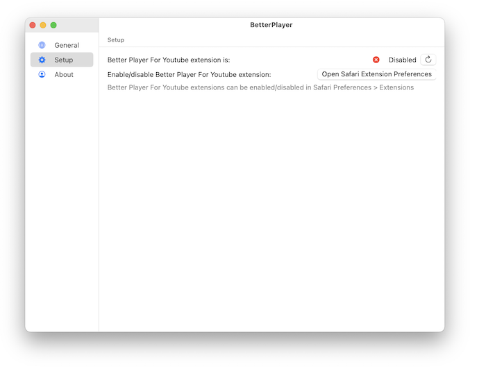
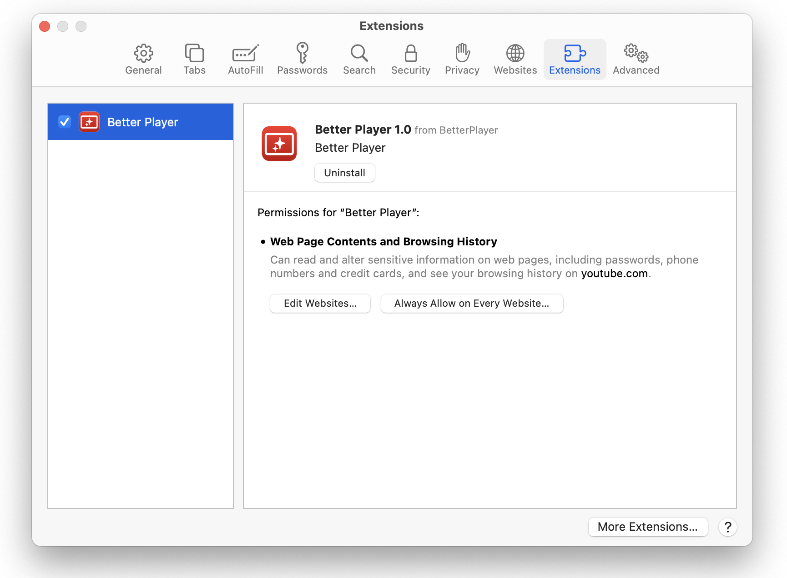
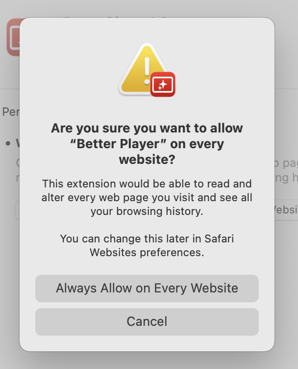
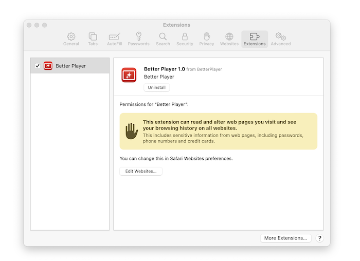
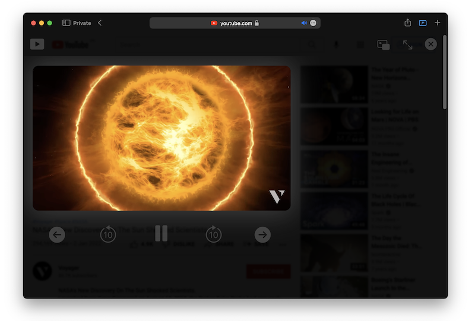
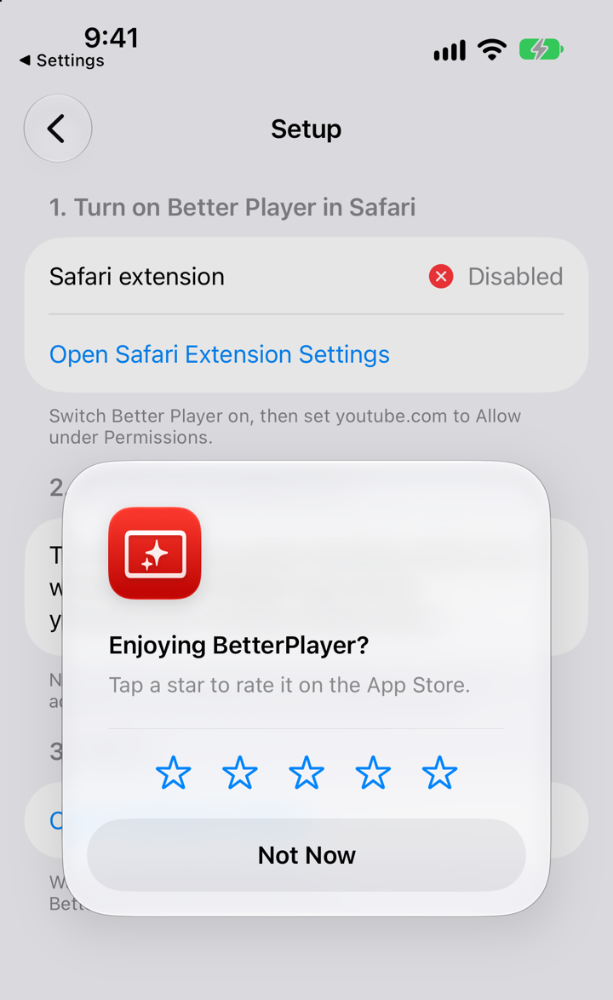
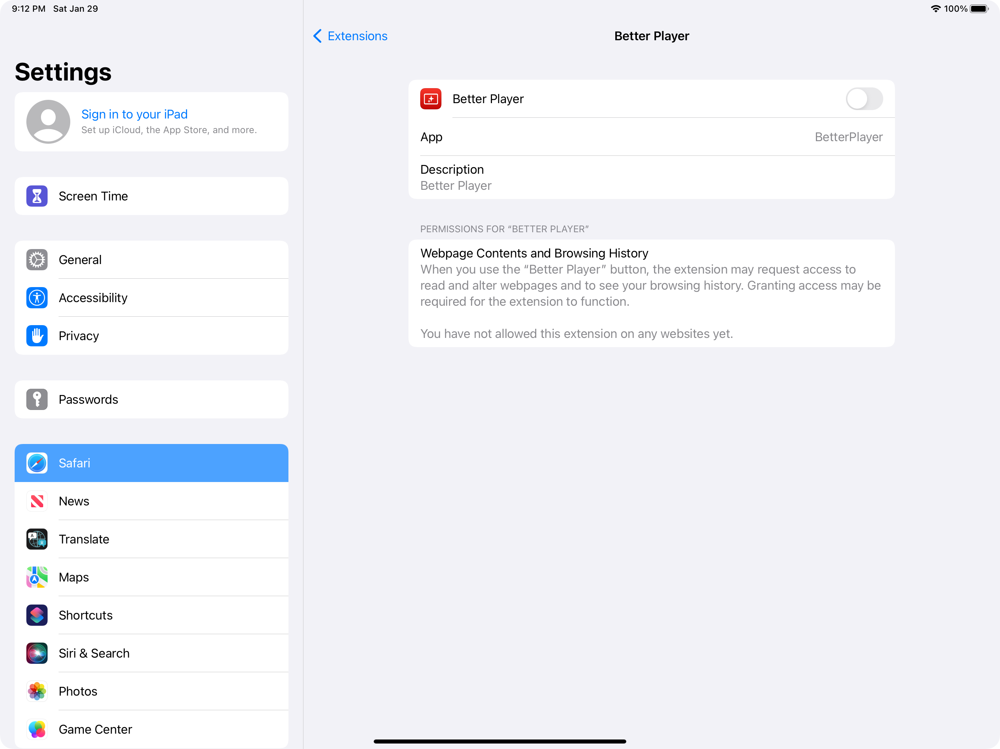
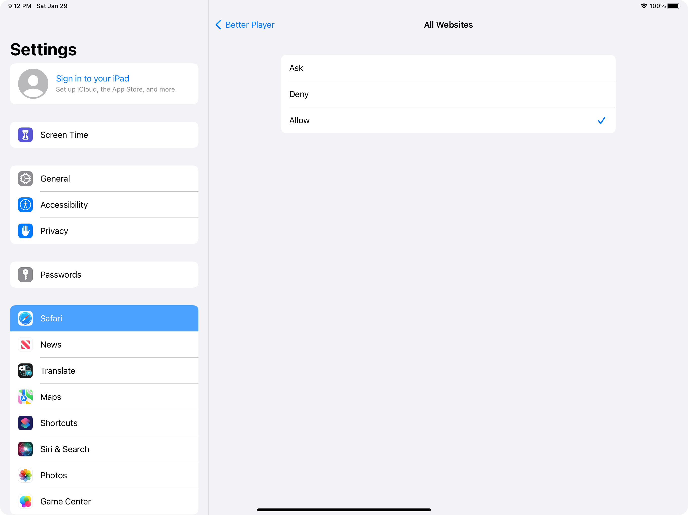
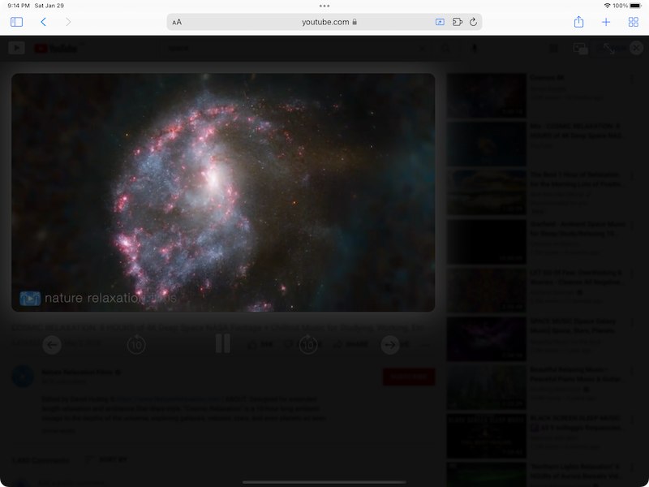

# Better Player for Youtube — Setup & Help

[← Better Player](/better-player/)

Setting it up, what changed in each version, and the privacy policy. What the
app does is on the [product page](/better-player/).

- [Downloads](#downloads)
- [Version History](#version-history)
- [Installation Guide](#installation-guide)
- [Privacy Policy](#privacy-policy)

## Downloads
The latest version of Better Player for Youtube is available in AppStore:

## Version History
### v1.4.11
* Ambient light — the video casts a glow in the colours of the frame playing, with size and strength in settings
* Focus mode now applies to Shorts, and hides the action buttons beside the reel
* The video is centred in the window
* The app and its settings in eleven languages
* Fixes: focus mode no longer leaves a black page when YouTube rebuilds its player; the Focus Mode and auto-start switches now do what they say

*Versions between v1.2.0 and v1.4.11 are not listed here.*

### v1.2.0
* Set up to show / hide buttons
* Set up to change background and button colors

### v1.1.2
* Fix for the issue with Youtube's 'keep hovering to play'

### v1.1.0
* Now support iPhone as well as iPad and Mac
* Buy once and run across all platforms
* Bugfix

### v1.0.2
* iPad version is also available for iOS 15
* UI enhancement for the embedded toolbars
* Settings for adblock and auto-load

## Installation Guide
### macOS
1. Launch Better Player for Youtube application. Select *Setup* in side bar of the application. And click *Open Safari Extensions Preferences* button. 

  

2. It will open Safari's Extensions Preferences. Please check the check-box next to Better Player. Then, click *Always Allow on Every Websites...* button.

  

3. Safari will open the following warning. Because of the way Better Player for Youtube works, the Better Player for Youtube extension needs to have permission to access to the website. Better Player for Youtube does NOT collect any of your data. Please refer [Privacy Policy](#privacy-policy) for details.

  

4. Once Better Player for Youtube set up is done, you will see Safari's Extension Preferences as follows;

  

5. All set. Go to *youtube.com* and play the youtube video you want to watch. You'll see the Better Player for Youtube darken the background of the video and it skips the ads.

  

### iPhone and iPad
Better Player is a Safari extension: there is no separate app to watch in. You switch it on once, allow it on youtube.com, and carry on watching in Safari.

**1. Turn on Better Player in Safari**

Open the Better Player app. It opens on *Setup*, which shows whether the extension is on. Tap *Open Safari Extension Settings* and switch Better Player on. (The button and the Enabled / Disabled line need Better Player 1.5.8 and iOS 26.2 or later.)

  

On an earlier version, find the switch yourself, either way:

* In the Settings app: *Settings > Apps > Safari > Extensions > Better Player* (*Settings > Safari > Extensions* before iOS 18).
* Without leaving Safari: tap the page menu beside the address, choose *Manage Extensions* and switch Better Player on.

  

**2. Allow it on youtube.com**

On the same settings page, under *Permissions*, set *youtube.com* to *Allow*. If you skip this, Safari asks the first time you open YouTube whether Better Player may run there: choose *Always Allow*. If Safari does not ask, tap the page menu beside the address, choose *Better Player* and allow it there.

Safari asks because Better Player restyles the YouTube page; it does not collect any of your data. See the [Privacy Policy](#privacy-policy).

  

**3. Watch in Safari**

Tap *Open YouTube in Safari* in the app, or open *youtube.com* in Safari yourself, and play a video. Watch in Safari, not in the YouTube app: Better Player works inside Safari. The page dims around the video and the ads are skipped.

  

**If nothing changes**

* Reload the page. A tab that was open before the extension was switched on does not have it yet.
* Check that you are on youtube.com in Safari and not in the YouTube app.
* Tap the page menu beside the address: Better Player should be listed and allowed for youtube.com.

## Privacy Policy
Better Player for Youtube does NOT collect any of your data. The only data Better Player for Youtube stores are your settings. These are only saved locally. No one, other than you, has access to this data.

Because of the way Better Player for Youtube works, the Better Player for Youtube extension needs to have permission to access to the website. This is needed because Better Player for Youtube has to add javascript to control Youtube videos and darken the page. However, Better Player for Youtube never use these permissions to actually read the websites you visit, or to access your browsing history. 

Better Player for Youtube does not store any information about the websites you're visiting. Not even locally on your device.

In Safari Preference, you can Allow or Deny the extensions to specific websites. In case you want to be extra cautious to certain websites, you can enable or disable Better Player for Youtube to the specific websites only.

English | [Korean](/kr/better-player) 
