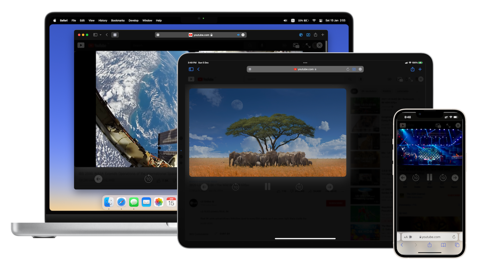
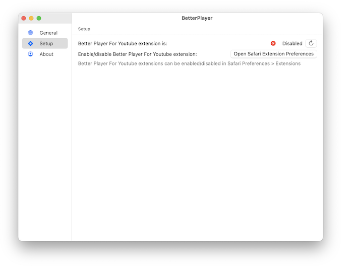
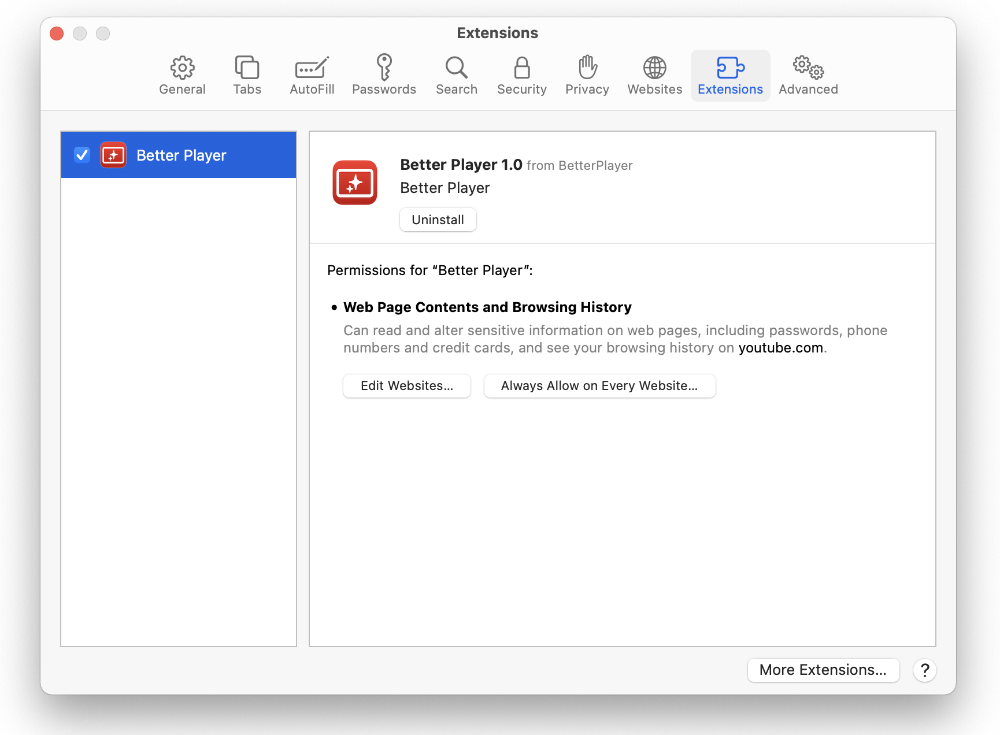
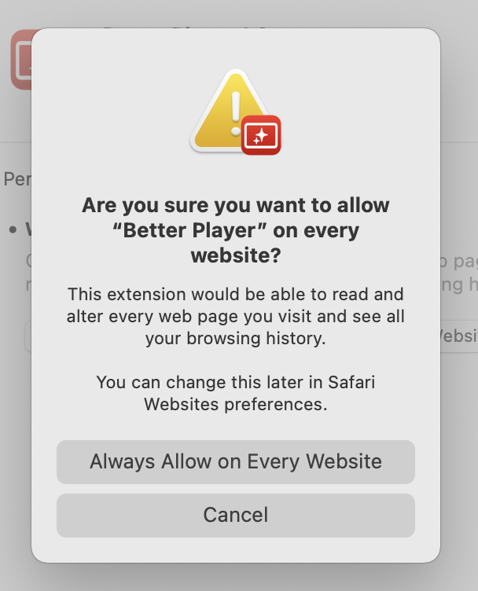
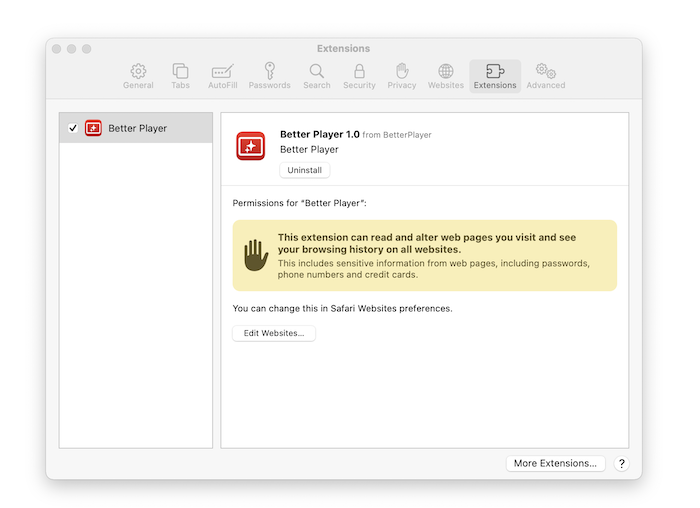
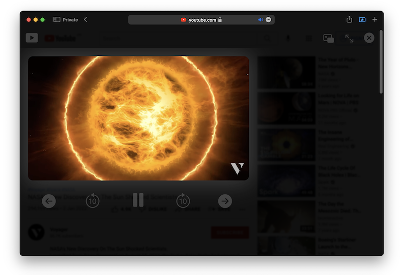
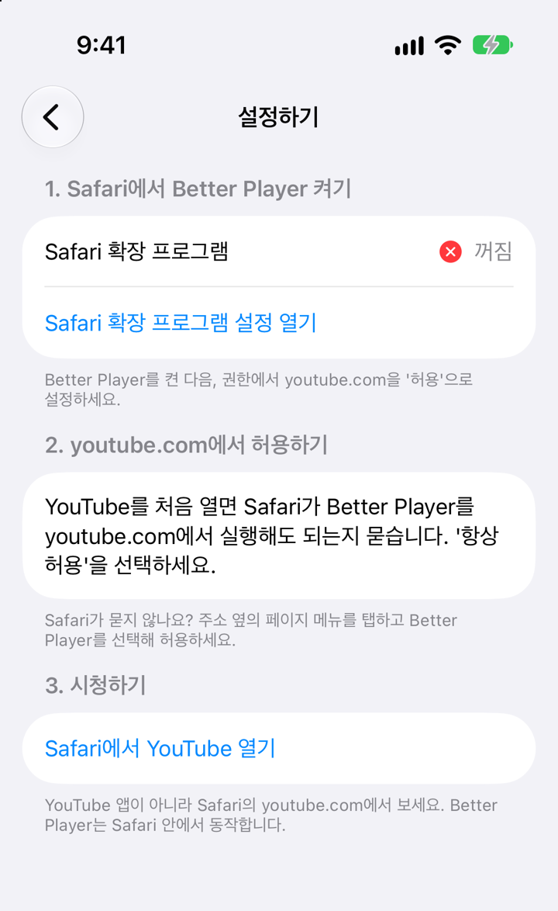
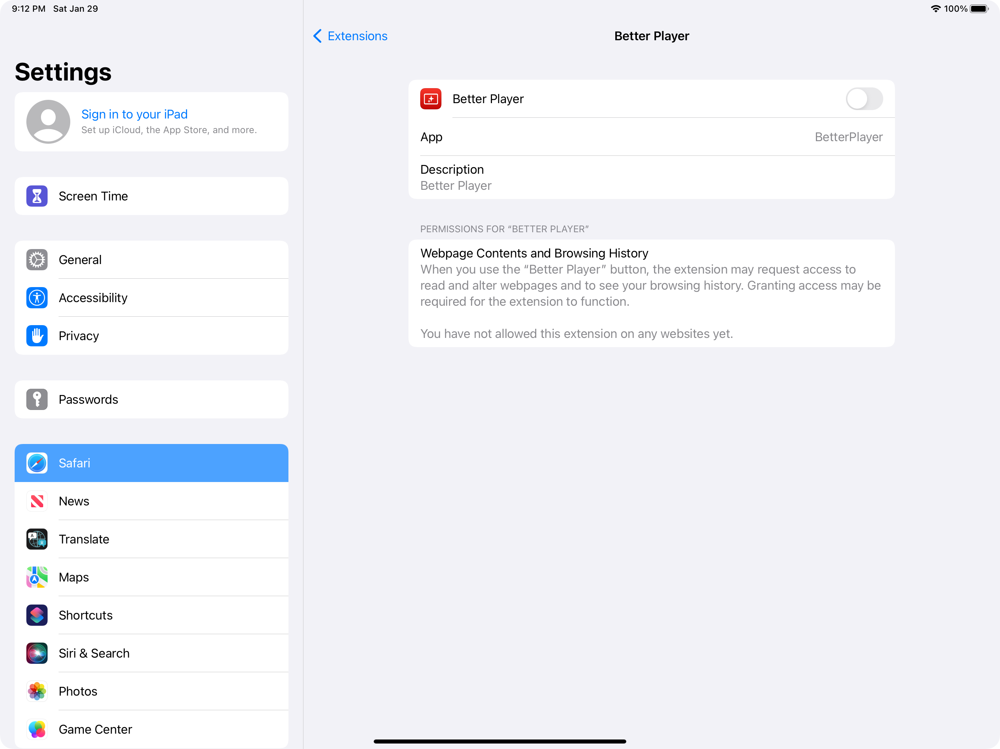
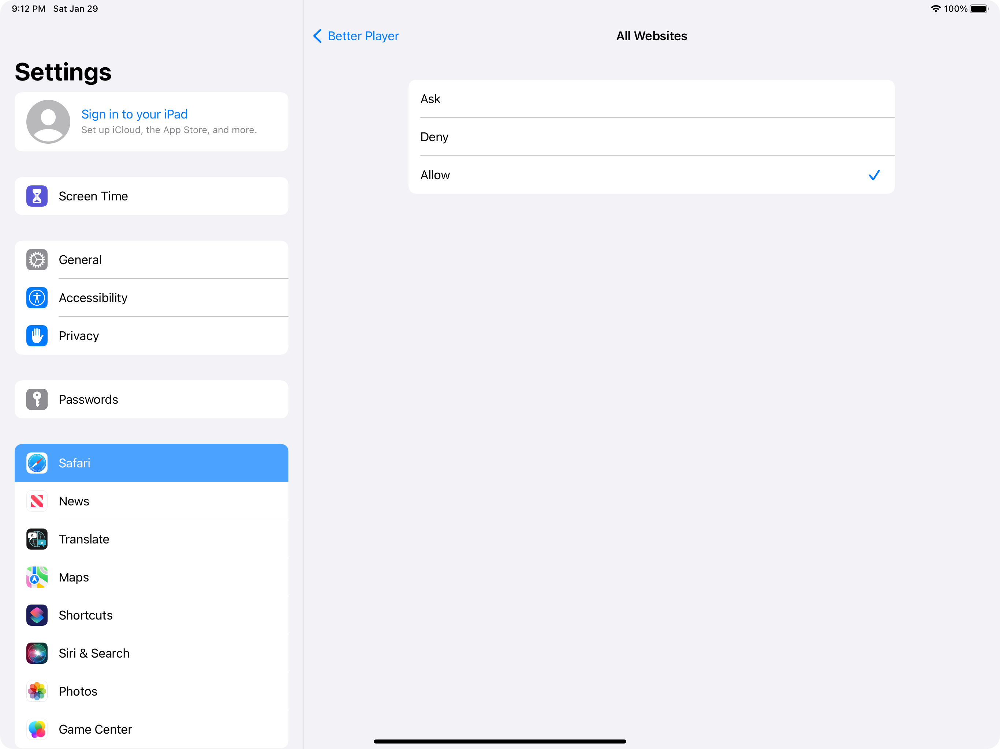
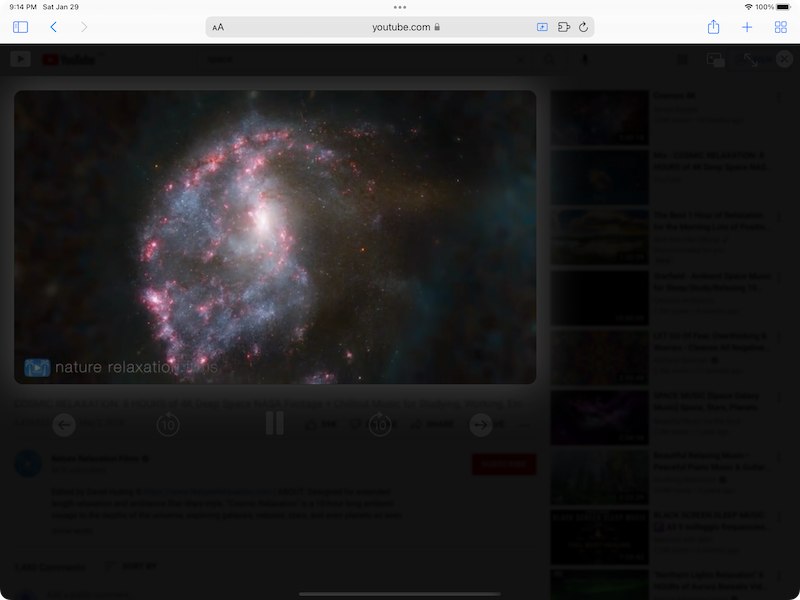

# Better Player for Youtube

- [소개](#소개)
- [다운로드](#다운로드)
- [버전 기록](#버전-기록)
- [설치 가이드](#설치-가이드)
- [개인 정보 정책](#개인-정보-정책)

## 소개
Better Player for Youtube는 iPhone, iPad 및 Mac 용 Youtube 동영상 시청을 마치 영화관에서 영화를 보는 것과 같은 경험을 제공하는 Safari 확장 프로그램입니다. Better Player for Youtube는 비디오 이외의 다른 영역을 어둡게 하여 동영상에 집중할 수 있도록 도와줍니다. 또한, Youtube용 Ad-block이 내장되어 Youtube 광고를 자동으로 건너뛰게 합니다.

  

* 전체 화면 또는 picture-in-picture 모드에서 동영상을 재생할 수 있습니다.
* Better Player는 모든 광고를 차단합니다.
* Better Player는 Youtube에 내장 된 컨트롤러로 배경을 자동으로 어둡게 합니다.

## 다운로드
Better Player for YouTube의 최신 버전은 App Store에서 다운로드할 수 있습니다.

## 버전 기록
### v1.2.0
* 버튼 표시/숨기기 설정
* 배경 및 버튼 색깔을 변경하도록 설정

### v1.1.2
* Youtube에서 '마우스로 가리키면 계속 재생' 문제 수정

### v1.1.0
* iPad 및 Mac은 물론 iPhone을 지원
* 한 번 구매하면 모든 플랫폼에서 실행
* 버그 수정

### v1.0.2
* iPad 버전은 iOS 15에서도 사용할 수 있습니다.
* 포함된 도구 모음의 UI 개선
* 광고 차단 및 자동 로드 설정

## 설치 가이드
### macOS
1. Better Player for Youtube 앱을 실행합니다. 애플리케이션의 사이드 바에서 "*설정*"을 선택하십시오. 그리고 "*Safari 확장 프로그램 환경설정 열기*" 버튼을 클릭합니다. 

  

2. Safari의 확장 환경 설정이 열리면 Better Player 옆의 확인란을 선택하십시오. 그런 다음 "*모든 웹사이트에서 항상 허용...*" 버튼을 클릭합니다.	

  

3. Safari는 다음 경고를 안내합니다: Better Player for Youtube가 작동하는 방식 때문에 본 확장 프로그램은 웹사이트에 액세스할 수 있는 권한이 있어야 합니다. Better Player for Youtube는 귀하의 데이터를 수집하지 않습니다. 자세한 내용은 [개인 정보 정책](#개인-정보-정책)을 참조하시기 바랍니다.

  

4. Better Player for Youtube 설정이 완료되면 Safari의 확장 설정이 다음과 같이 표시됩니다.

  

5. 설정이 완료되었습니다. *youtube.com*으로 이동하여 원하는 YouTube 동영상을 재생합니다. Better Player for Youtube가 동영상 배경을 어둡게 하고 광고를 건너뛰는 것을 볼 수 있습니다.

  

### iPhone 및 iPad
Better Player는 Safari 확장 프로그램입니다. 영상을 볼 별도의 앱이 없습니다. 한 번 켜고 youtube.com에서 허용한 다음, 쓰던 Safari에서 그대로 보면 됩니다.

**1. Safari에서 Better Player 켜기**

Better Player 앱을 엽니다. 앱은 확장 프로그램이 켜져 있는지 보여 주는 "*설정하기*" 화면으로 열립니다. "*Safari 확장 프로그램 설정 열기*"를 탭하고 Better Player를 켭니다. (이 버튼과 켜짐 / 꺼짐 표시는 Better Player 1.5.8, iOS 26.2 이상에서 나옵니다.)

  

그 이전 버전에서는 아래 두 가지 중 한 가지 방법으로 직접 스위치를 찾습니다.

* 설정 앱에서: *설정 > 앱 > Safari > 확장 프로그램 > Better Player* (iOS 18 이전에는 *설정 > Safari > 확장 프로그램*).
* Safari를 떠나지 않고: 주소 옆의 페이지 메뉴를 탭하고 "*확장 프로그램 관리*"를 선택한 다음 Better Player를 켭니다.

  

**2. youtube.com에서 허용하기**

같은 설정 화면의 "*권한*"에서 *youtube.com*을 "*허용*"으로 설정합니다. 이 단계를 건너뛰면 YouTube를 처음 열 때 Safari가 Better Player를 실행해도 되는지 묻습니다. "*항상 허용*"을 선택하세요. Safari가 묻지 않으면 주소 옆의 페이지 메뉴를 탭하고 *Better Player*를 선택해 허용합니다.

Safari가 권한을 묻는 것은 Better Player가 YouTube 페이지의 모양을 바꾸기 때문이며, 데이터는 수집하지 않습니다. [개인 정보 정책](#개인-정보-정책)을 참조하세요.

  

**3. Safari에서 시청하기**

앱에서 "*Safari에서 YouTube 열기*"를 탭하거나 Safari에서 *youtube.com*을 직접 열고 동영상을 재생합니다. YouTube 앱이 아니라 Safari에서 보세요. Better Player는 Safari 안에서 동작합니다. 영상 주변이 어두워지고 광고를 건너뜁니다.

  

**아무 변화가 없다면**

* 페이지를 새로 고칩니다. 확장 프로그램을 켜기 전에 열려 있던 탭에는 아직 적용되지 않습니다.
* YouTube 앱이 아니라 Safari의 youtube.com인지 확인합니다.
* 주소 옆의 페이지 메뉴를 탭합니다. Better Player가 목록에 있고 youtube.com에서 허용되어 있어야 합니다.

## 개인 정보 정책
Better Player for Youtube는 귀하의 데이터를 수집하지 않습니다. 설정 정보만 로컬에 저장되며, 당신 외에는 아무도 이 데이터에 접근할 수 없습니다.

Better Player for Youtube가 작동하는 방식 때문에 본 확장 프로그램은 웹사이트에 액세스할 수 있는 권한을 필요로 합니다. 이는 Better Player for Youtube가 Youtube 비디오를 제어하고 페이지를 어둡게 하기 위해 javascript를 추가해야 하기 때문에 필요합니다. Better Player for Youtube는 방문한 웹사이트를 읽거나 검색 기록에 액세스하는 데 이러한 권한을 사용하지 않으며, 귀하가 방문하는 웹사이트에 대한 정보를 저장하지 않습니다.

Safari 환경설정에서 특정 웹사이트에 대해서만 Better Player for Youtube를 활성화 또는 비활성화할 수 있습니다.

[English](/better-player) | Korean
